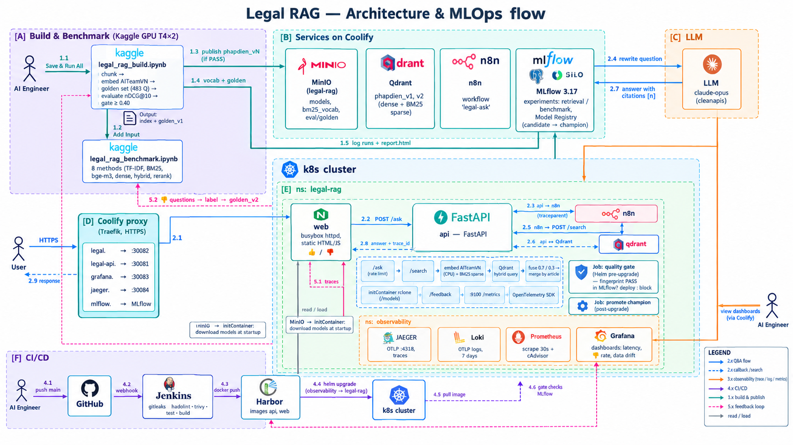
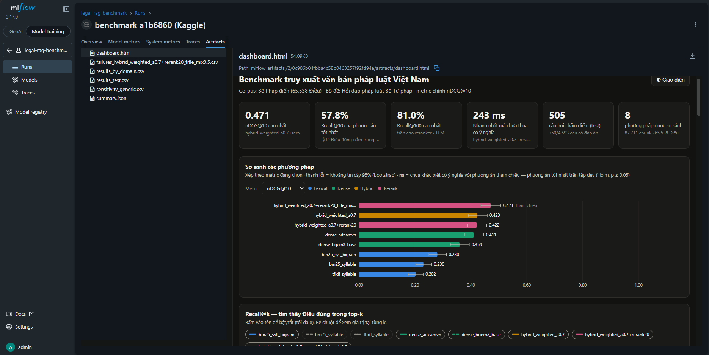
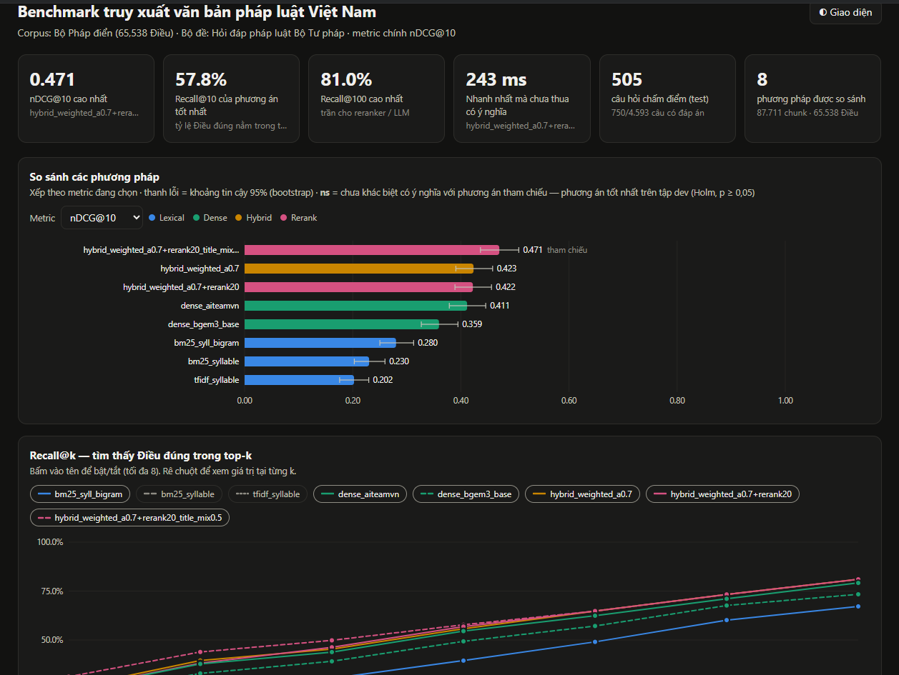
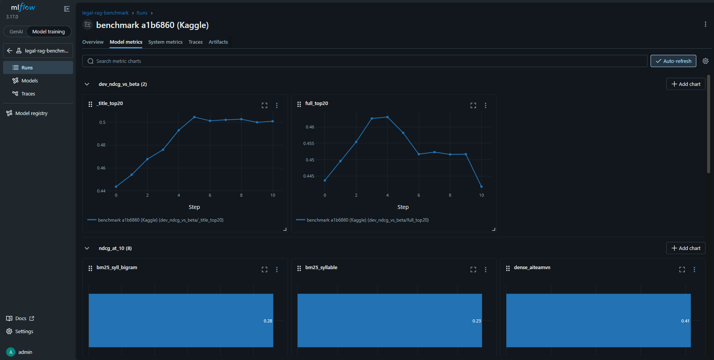
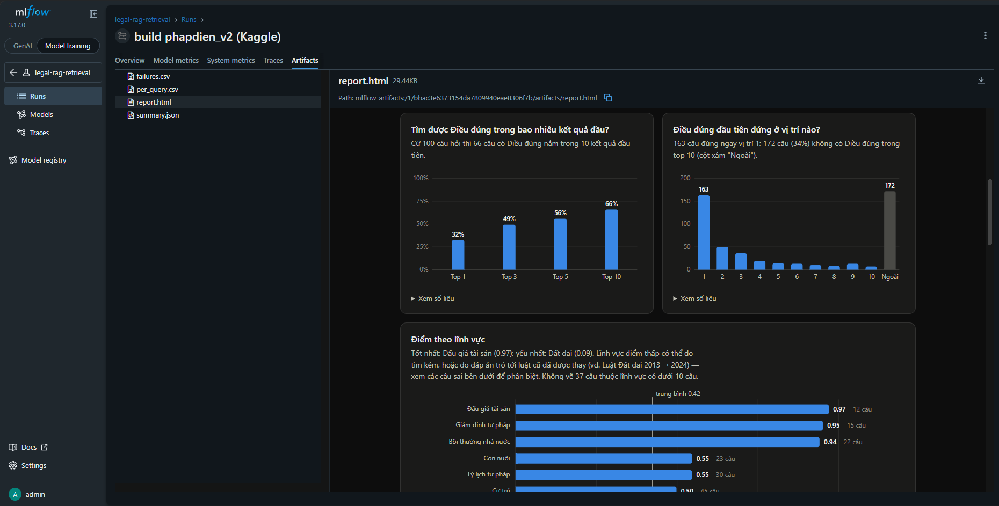
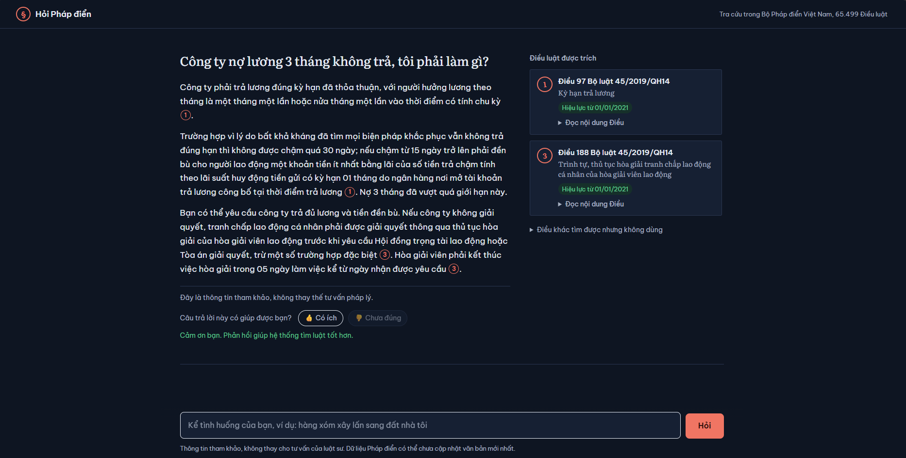
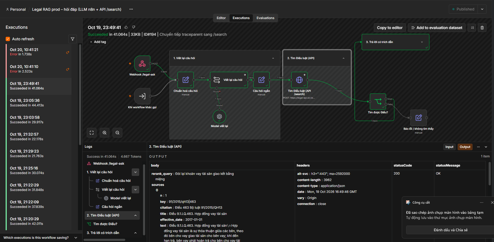
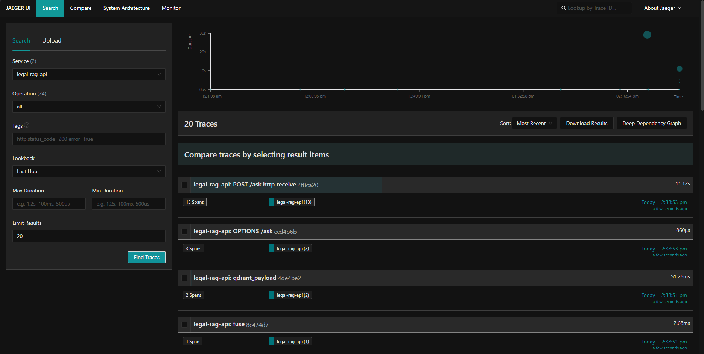
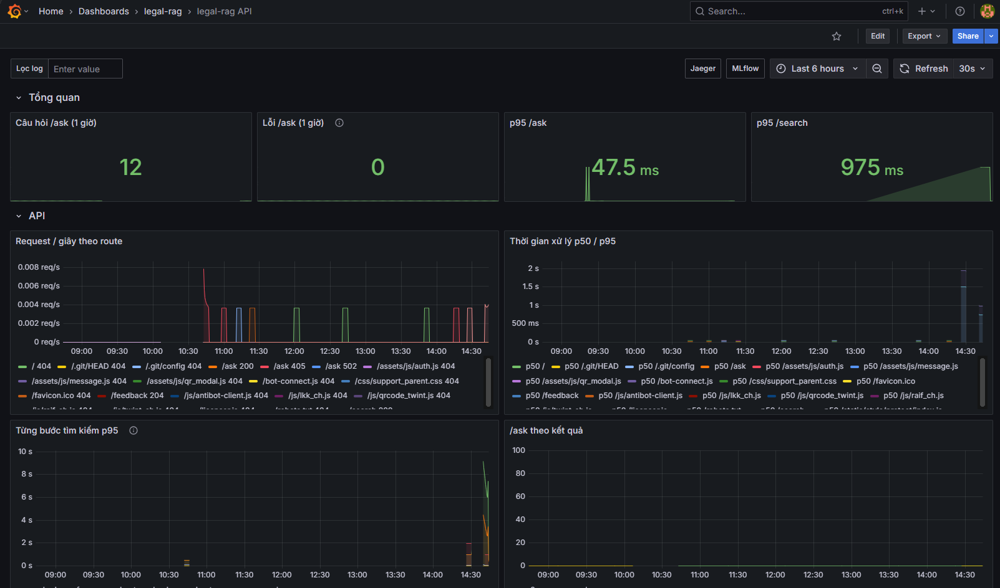
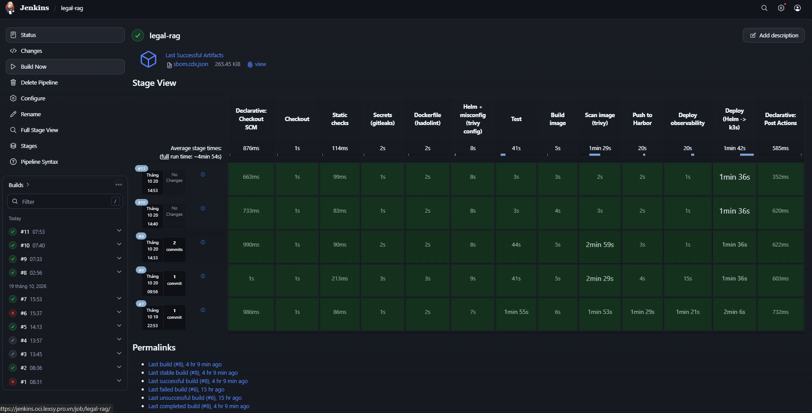

# **Legal RAG — Vietnamese Legal Q&A with a full MLOps loop on k3s**

- [**Legal RAG — Vietnamese Legal Q\&A with a full MLOps loop on k3s**](#legal-rag--vietnamese-legal-qa-with-a-full-mlops-loop-on-k3s)
  - [I. Overview](#i-overview)
  - [II. Prepare the infrastructure](#ii-prepare-the-infrastructure)
      - [1. k3s cluster and namespaces](#1-k3s-cluster-and-namespaces)
      - [2. Services on Coolify (Qdrant, MinIO, n8n, Harbor, Jenkins)](#2-services-on-coolify-qdrant-minio-n8n-harbor-jenkins)
      - [3. MLflow stack](#3-mlflow-stack)
      - [4. Secrets](#4-secrets)
      - [5. Domains: Coolify proxy to NodePorts](#5-domains-coolify-proxy-to-nodeports)
  - [III. Build the data and evaluate on Kaggle](#iii-build-the-data-and-evaluate-on-kaggle)
      - [1. Chunking and embedding the Legal Code](#1-chunking-and-embedding-the-legal-code)
      - [2. Golden set: questions with known answers](#2-golden-set-questions-with-known-answers)
      - [3. Evaluate, gate and publish](#3-evaluate-gate-and-publish)
      - [4. Benchmark 8 retrieval methods](#4-benchmark-8-retrieval-methods)
  - [IV. Deploy the serving stack with Helm](#iv-deploy-the-serving-stack-with-helm)
      - [1. API (FastAPI) and web UI](#1-api-fastapi-and-web-ui)
      - [2. n8n workflow and the LLM](#2-n8n-workflow-and-the-llm)
      - [3. Quality gate before every deploy](#3-quality-gate-before-every-deploy)
  - [V. Deploy the observability stack](#v-deploy-the-observability-stack)
      - [1. Tracing with Jaeger \& OpenTelemetry](#1-tracing-with-jaeger--opentelemetry)
      - [2. Logs with Loki, metrics with Prometheus, dashboards in Grafana](#2-logs-with-loki-metrics-with-prometheus-dashboards-in-grafana)
  - [VI. Setup Jenkins (CI/CD)](#vi-setup-jenkins-cicd)
      - [1. Connect Jenkins to k3s](#1-connect-jenkins-to-k3s)
      - [2. Add Harbor credentials](#2-add-harbor-credentials)
      - [3. Create the Multibranch Pipeline and the GitHub webhook](#3-create-the-multibranch-pipeline-and-the-github-webhook)
      - [4. What the pipeline does](#4-what-the-pipeline-does)
  - [VII. Monitoring quality in production \& the feedback loop](#vii-monitoring-quality-in-production--the-feedback-loop)
  - [VIII. Demo \& results](#viii-demo--results)
      - [1. Demo: asking a question](#1-demo-asking-a-question)
      - [2. Retrieval quality](#2-retrieval-quality)
      - [3. Release a new data version end to end](#3-release-a-new-data-version-end-to-end)
  - [IX. Troubleshooting](#ix-troubleshooting)


## I. Overview
Legal RAG answers legal questions from Vietnamese citizens and cites, for every claim, the exact Article (Điều) of the **Vietnamese Legal Code (Bộ Pháp điển — 65,499 Articles, 87,711 chunks)** it relies on. Retrieval is a hybrid of dense embeddings and BM25 served from Qdrant; an LLM inside an n8n workflow rewrites the question and writes the final answer with citations `[n]`.

The project is built as an **MLOps system**, not just an app: every data or model version is built and scored reproducibly on Kaggle, tracked in MLflow, and **can only reach production through an automatic quality gate**. Production quality is then watched with traces, logs, metrics and user feedback, and the questions users reject flow back into the evaluation set.



**Technology:**
* Source control: Git/GitHub
* CI/CD: Jenkins (gitleaks, hadolint, trivy, tests, build, Helm deploy)
* Container registry: Harbor
* Build API: FastAPI
* Web UI: static HTML/JS served by busybox httpd
* Containerize application: Docker
* Container orchestration: k3s (single node, 2 vCPU / ~12 GB RAM)
* K8s package manager: Helm
* Reverse proxy & HTTPS: Coolify (Traefik)
* Vector database: Qdrant (dense + sparse BM25 vectors)
* Object storage for models, vocabularies and the golden set: MinIO
* Workflow & LLM orchestration: n8n
* Build, evaluation & benchmark: Kaggle notebooks (GPU T4 × 2)
* Experiment tracking & model registry: MLflow 3.17 (PostgreSQL + S3 artifacts)
* Observability: OpenTelemetry, Jaeger, Loki, Prometheus, Grafana

**Machine Learning Models:**
* Embedding model: [AITeamVN/Vietnamese_Embedding](https://huggingface.co/AITeamVN/Vietnamese_Embedding) (fine-tuned from bge-m3, 1024 dims)
* Reranker (optional, off in production): [AITeamVN/Vietnamese_Reranker](https://huggingface.co/AITeamVN/Vietnamese_Reranker)
* Large language model: claude-opus via an OpenAI-compatible API, called from n8n

**Data Source:**
* Corpus: [tmquan/phapdien-moj-gov-vn](https://huggingface.co/datasets/tmquan/phapdien-moj-gov-vn) — the Vietnamese Legal Code from the Ministry of Justice
* Evaluation questions: [tmquan/pbgdpl-vn-legal-qna](https://huggingface.co/datasets/tmquan/pbgdpl-vn-legal-qna) — 4,593 real citizen questions answered by Ministry of Justice officers

**Project Structure**
```txt
  ├── legal_core                         /* Retrieval algorithm shared by production and build: text normalisation, fusion, Config */
  ├── pipeline                           /* Build side: structure-aware chunker, GPU embedding, BM25, publish to Qdrant */
  │    ├── chunker.py                    /* Article -> Clause -> Point -> sentence chunking, ≤ 512 tokens */
  │    ├── embed.py                      /* Multi-GPU embedding with resumable shards */
  │    └── publish_qdrant.py             /* Push one data version as collection phapdien_vN + export the BM25 vocabulary */
  ├── prod                               /* Serving side */
  │    ├── app.py                        /* FastAPI: /ask, /search, /feedback, /health */
  │    ├── qdrant_retriever.py           /* Hybrid query on Qdrant */
  │    └── telemetry.py                  /* OpenTelemetry traces & logs, Prometheus metrics */
  ├── mlops                              /* Evaluation, MLflow, quality gate, feedback */
  │    ├── labels.py, golden.py          /* Build and load the golden set (silver labels from cited Articles) */
  │    ├── evaluate.py                   /* check / run / promote — the quality gate */
  │    ├── report.py                     /* One-page HTML report with charts, logged to MLflow */
  │    ├── mlflow_rest.py                /* Minimal MLflow REST client (no mlflow package in the image) */
  │    ├── feedback.py                   /* Collect thumbs-down questions from Loki, merge into a new golden set */
  │    └── bench_lib.py, bench_*.py      /* Library, dashboard and MLflow logging for the benchmark notebook */
  ├── kaggle
  │    ├── legal_rag_build.ipynb         /* Build index + golden set, evaluate, gate, publish */
  │    └── legal_rag_benchmark.ipynb     /* Compare 8 retrieval methods, log to MLflow */
  ├── helm
  │    ├── legal-rag                     /* API + web + quality-gate Jobs (templates/eval-job.yaml) */
  │    └── observability                 /* Jaeger, Loki, Prometheus, Grafana + cluster-rbac.yaml */
  ├── web                                /* Web UI (index.html, app.js, styles.css) */
  ├── tests/test_all.py                  /* Full test suite run by Jenkins (in-memory Qdrant, fake models, fake MLflow) */
  ├── images                             /* Images displayed in this README */
  ├── docs/OPERATIONS.md                 /* Operator notes (Vietnamese) */
  ├── Dockerfile                         /* Stages: base -> test -> runtime; torch layer separated from light deps */
  └── Jenkinsfile                        /* CI/CD pipeline */
```

## II. Prepare the infrastructure
Everything runs on **one VM**: k3s for the app and observability, Coolify for the shared services and HTTPS. k3s is installed with Traefik and ServiceLB disabled — Coolify's proxy is the only entry point and forwards each domain to a NodePort.

#### 1. k3s cluster and namespaces
Create the application namespace and give Jenkins' ServiceAccount admin rights **inside** it:
```bash
kubectl create namespace legal-rag
kubectl -n legal-rag create rolebinding jenkins-deployer --clusterrole=admin --serviceaccount=demo:jenkins-deployer
```
The observability namespace also needs one cluster-level permission (Prometheus reads pods, nodes and cAdvisor), which Jenkins cannot create — a cluster admin applies it once:
```bash
kubectl apply -f helm/observability/cluster-rbac.yaml
kubectl auth can-i create deployments -n observability --as=system:serviceaccount:demo:jenkins-deployer   # yes
```


#### 2. Services on Coolify (Qdrant, MinIO, n8n, Harbor, Jenkins)
| Service | Used for |
|---|---|
| Qdrant | collections `phapdien_v1`, `phapdien_v2`… (dense + sparse `bm25`) |
| MinIO (bucket `legal-rag`) | `models/vietnamese-embedding/main`, `data/phapdien_vN/bm25_vocab.json.gz`, `eval/golden_vK.jsonl.gz` |
| n8n | workflow `legal-ask` (LLM rewrite → `/search` → LLM answer) |
| Harbor | project `legal-rag`, images `api` and `web`, robot account for Jenkins |
| Jenkins | Multibranch Pipeline connected to GitHub |

Upload the embedding model to MinIO once; the API pod downloads it at startup with an `rclone` initContainer, so the image stays small and a data change never needs an image rebuild.

#### 3. MLflow stack
MLflow runs on Coolify as a Docker Compose stack: `mlflow` + `postgres:18` (backend store, required by the Model Registry) + SILO/MinIO (artifact store) + a one-shot `createbucket` container.
```bash
mlflow server --app-name basic-auth \
  --backend-store-uri postgresql://<user>:<password>@postgres:5432/mlflow \
  --artifacts-destination s3://mlflow \
  --allowed-hosts "${MLFLOW_DOMAIN},localhost,127.0.0.1" \
  --cors-allowed-origins "https://${MLFLOW_DOMAIN}" \
  --host 0.0.0.0 --port 5000
```
> `--cors-allowed-origins` is required behind a TLS-terminating proxy: without it MLflow's security middleware blocks the UI's own POST requests and the Runs page shows `INTERNAL_ERROR`.

Check that pods can reach it:
```bash
kubectl -n legal-rag run mlcheck --rm -it --restart=Never --image=curlimages/curl -- \
  curl -s -u admin:'<password>' -X POST https://mlflow.oci.lexsy.pro.vn/api/2.0/mlflow/experiments/search \
  -H 'Content-Type: application/json' -d '{"max_results":1}'
```


#### 4. Secrets
Secrets are created by hand and never stored in git or Jenkins:
```bash
kubectl -n legal-rag create secret generic legal-rag-secrets \
  --from-literal=QDRANT_API_KEY='<read-only key>' \
  --from-literal=API_TOKEN='<key used by n8n for /search>' \
  --from-literal=S3_ACCESS_KEY='<read-only MinIO user>' --from-literal=S3_SECRET_KEY='<...>' \
  --from-literal=MLFLOW_TRACKING_USERNAME='<user>' --from-literal=MLFLOW_TRACKING_PASSWORD='<...>'
kubectl -n legal-rag create secret docker-registry harbor-pull --docker-server=harbor.oci.lexsy.pro.vn \
  --docker-username='<robot>' --docker-password='<...>'
kubectl -n observability create secret generic grafana-admin \
  --from-literal=admin-user=admin --from-literal=admin-password='<...>'
```

#### 5. Domains: Coolify proxy to NodePorts
| Domain | NodePort | Service |
|---|---|---|
| `legal.oci.lexsy.pro.vn` | 30082 | Web UI |
| `legal-api.oci.lexsy.pro.vn` | 30081 | API |
| `grafana.oci.lexsy.pro.vn` | 30083 | Grafana |
| `jaeger.oci.lexsy.pro.vn` | 30084 | Jaeger UI |

Add one route per domain in Coolify pointing to `http://<node-ip>:<nodeport>`. Large image pushes to Harbor also need Traefik's read timeout lifted (`--entrypoints.https.transport.respondingTimeouts.readTimeout=0s`), otherwise uploads longer than 60 s are cut.

## III. Build the data and evaluate on Kaggle
All heavy work — chunking, GPU embedding, building the golden set, scoring — runs in **one Kaggle notebook**, `kaggle/legal_rag_build.ipynb`. The notebook contains no processing code: its first cell clones this repository and imports `pipeline/` and `mlops/`, so Kaggle and production always run the exact same algorithm.

Settings: **GPU T4 × 2**, **Internet on**, and these **Secrets** (Add-ons → Secrets): `QDRANT_URL`, `QDRANT_API_KEY` (write), `S3_ENDPOINT`, `S3_ACCESS_KEY`, `S3_SECRET_KEY` (write), `MLFLOW_TRACKING_URI`, `MLFLOW_TRACKING_USERNAME`, `MLFLOW_TRACKING_PASSWORD`.


#### 1. Chunking and embedding the Legal Code
The dataset is pinned to its HuggingFace revision. Each Article is split along the legal structure (Article → Clause → Point → sentence) into chunks of at most 512 tokens, each carrying a header with its subject and Article title. Embedding runs in fp16 on both GPUs and saves shards, so an interrupted run resumes where it stopped (~30–40 min for 87,711 chunks).

#### 2. Golden set: questions with known answers
The golden set is built automatically from real citizen questions (`mlops/labels.py`):
1. extract citations such as *"khoản 1 Điều 241 Bộ luật Dân sự năm 2015"* from the officer's answer and map them to Article keys in the Legal Code;
2. if no year is given, pick the law version in force on the date the question was asked;
3. keep an Article only if the answer really talks about it (title overlap or copied passages), with thresholds calibrated on the dev split to ≤ 2 % false matches;
4. split dev / test 30 / 70 with seed 42 **before** labelling, so the test split is never seen while tuning.

Result: **711 questions with answers, 483 in the test split**. The file `golden_v1.jsonl.gz` is versioned on MinIO and never overwritten.

#### 3. Evaluate, gate and publish
The production configuration (hybrid 0.7 · dense + 0.3 · BM25, no rerank) is scored on the test split and compared with the current **champion** in MLflow. The run passes when **nDCG@10 ≥ 0.40 and it is not more than 0.01 below the champion**. With `PUBLISH = True`, a passing run:
* uploads collection `phapdien_vN` to Qdrant and the BM25 vocabulary + golden set to MinIO,
* logs a run with `gate = passed` (metrics, parameters, `report.html`, `per_query.csv`, `failures.csv`) to the MLflow experiment `legal-rag-retrieval`,
* registers a new version of the model `legal-rag-retriever` with alias **`candidate`**.

| Variable | Meaning |
|---|---|
| `DATA_VERSION` | collection to create, `phapdien_v{N}` — always increase it |
| `GOLDEN_VERSION`, `BUILD_GOLDEN` | build a new golden set (`True`) or download the existing one to stay comparable with the champion (`False`) |
| `PUBLISH` | push to production when the gate passes |
| `LIMIT_ROWS` | quick smoke test on N Articles (never publishes) |

Run it with **Save Version → Save & Run All** so the output (index + golden set) is saved for the benchmark notebook.



#### 4. Benchmark 8 retrieval methods
`kaggle/legal_rag_benchmark.ipynb` takes the build notebook's output as **Input** and compares 8 methods on the same index and the same golden set: TF-IDF → BM25 syllables → BM25 syllables + bigrams → bge-m3 → AITeamVN → hybrid → hybrid + rerank (question) → hybrid + rerank (title, score mixing). Parameters (k1, b, α, β) are tuned on dev, scored on test, with bootstrap confidence intervals and paired randomization tests corrected with Holm. Everything is logged to the MLflow experiment `legal-rag-benchmark`: a parent run with `dashboard.html` and the α / β tuning curves, and one child run per method (all metrics, Recall@k curve).



## IV. Deploy the serving stack with Helm
In normal operation Jenkins deploys everything (section VI). The commands below are what it runs.

#### 1. API (FastAPI) and web UI
```bash
helm upgrade --install legal-rag helm/legal-rag --namespace legal-rag \
  --set image.repository=harbor.oci.lexsy.pro.vn/legal-rag/api --set image.tag=<tag> \
  --atomic --wait --timeout 30m
```
`values.yaml` holds what changes between releases: `data.version` (which `phapdien_vN` to serve), `rerank.enabled`, model paths on MinIO, `quality.*` (gate settings), `observability.*`. The API exposes:
```
POST /ask       (web UI)   {"question": "...", "k": 5}  -> forwards to n8n, returns answer + sources + trace_id
POST /search    (n8n, X-API-Key) {"question": "...", "k": 8} -> top Articles with full text
POST /feedback  (web UI)   {"vote": "up"|"down", "trace_id", "question", "sources"}
GET  /health
```


#### 2. n8n workflow and the LLM
The workflow `legal-ask` receives the question from `/ask`, asks the LLM to rewrite it into a short legal title, calls `POST /search` on the API (forwarding the `traceparent` header so both halves share one trace), then asks the LLM to answer **only** from the returned Articles and cite them as `[n]`.


#### 3. Quality gate before every deploy
Before Helm replaces the pods, a pre-upgrade **Job** checks MLflow for a passing run with the same **configuration fingerprint** (collection + model paths + `Config` parameters + golden set). Code-only changes reuse the existing result and skip in seconds; a new data version, model or parameter triggers a full evaluation on the cluster, and a failing score stops the deploy — production keeps the previous version. After a successful deploy, a post-upgrade Job moves the alias **`champion`** to the new version.


## V. Deploy the observability stack
One chart, `helm/observability`, deployed by Jenkins into the namespace `observability`. Resource requests are tiny (~150m CPU, ~700 Mi RAM in total) to fit a 2-vCPU node.
```bash
helm upgrade --install obs helm/observability --namespace observability --atomic --wait
```

#### 1. Tracing with Jaeger & OpenTelemetry
The API sends traces over OTLP straight to Jaeger (`jaeger.observability:4318`). One question = one trace: `POST /ask → n8n → POST /search → embed → qdrant_query → fuse → qdrant_payload`.


#### 2. Logs with Loki, metrics with Prometheus, dashboards in Grafana
* **Loki** receives the API's logs over OTLP; every line carries `trace_id`, so Grafana jumps from a log line to its trace and back.
* **Prometheus** scrapes the API on a private port (9100, not exposed through the NodePort) and container CPU/RAM from cAdvisor.
* **Grafana** ships with the provisioned dashboard **legal-rag API**: request rate and p95 latency per route, latency per search stage, n8n wait time, CPU/RAM per pod, logs, and a **Quality** row (section VII).

| Metric | Meaning |
|---|---|
| `legal_http_request_seconds{route,status}` | latency per route |
| `legal_search_stage_seconds{stage}` | embed / qdrant_query / fuse / qdrant_payload / rerank |
| `legal_ask_total{result}` | ok, no_answer, rate_limited, n8n_error |
| `legal_dense_top1_score` | cosine of the closest chunk — data-drift signal |
| `legal_feedback_total{vote}` | thumbs up / down from users |



## VI. Setup Jenkins (CI/CD)

#### 1. Connect Jenkins to k3s
Create a kubeconfig for the ServiceAccount `demo:jenkins-deployer` (admin in `legal-rag` and `observability` only) and store it in Jenkins as a **Secret file** credential named `kubeconfig-k3s`.
```bash
TOKEN=$(kubectl -n demo create token jenkins-deployer --duration=8760h)
```


#### 2. Add Harbor credentials
Create a robot account in the Harbor project `legal-rag` and add it as a **Username with password** credential named `harbor-legal-rag`.


#### 3. Create the Multibranch Pipeline and the GitHub webhook
New Item → **Multibranch Pipeline** → GitHub source → this repository; then add a GitHub webhook to `https://<jenkins>/github-webhook/` so every push to `main` builds and deploys.


#### 4. What the pipeline does
1. **Static checks** in parallel: gitleaks (leaked secrets), hadolint (Dockerfile), `helm lint`, trivy config.
2. **Test**: the Dockerfile `test` stage runs `tests/test_all.py` — chunker, labels, sparse encoding vs scikit-learn, Qdrant results identical to file results, API, telemetry, the full gate flow against a fake MLflow.
3. **Build** `legal-rag/api` and `legal-rag/web`, **scan** them with trivy and export an SBOM.
4. **Push** to Harbor (the ~1 GB torch layer is cached separately, so code changes push only a few MB).
5. **Deploy observability**, then **deploy the API** through the quality gate.



## VII. Monitoring quality in production & the feedback loop
The golden set protects quality **before** a deploy; user feedback watches it **after**. Every answer in the web UI has 👍 / 👎 buttons:
1. the vote goes to `POST /feedback` with the question, the Articles shown and the `trace_id`;
2. the API counts it in Prometheus and writes a log line to Loki;
3. Grafana's **Quality** row shows the 7-day thumbs-down rate (orange > 20 %, red > 30 %), the 24-hour "no Article found" rate, and the similarity between questions and the data (a falling p10 means users ask about things the Legal Code does not cover yet);
4. a rejected question opens in Jaeger with one click, to see whether retrieval or the LLM was wrong;
5. `python -m mlops.feedback` exports the rejected questions, a person labels the correct Articles, and `merge` produces `golden_v2` — from the next build on, the gate also scores the questions users complained about.


## VIII. Demo & results

#### 1. Demo: asking a question


#### 2. Retrieval quality
Production configuration on the test split (483 real questions):

| Metric | Value |
|---|---|
| nDCG@10 | **0.430** (95 % CI 0.394–0.466) |
| Correct Article at rank 1 (Hit@1) | 33 % |
| Correct Article in top 10 (Hit@10) | 66 % |
| MRR@10 | 0.427 |
| Retrieval latency p50 / p95 (Kaggle GPU) | 53 / 61 ms |

Benchmark of the 8 methods (previous run, 476 test questions):

| Method | nDCG@10 |
|---|---|
| Hybrid α = 0.7 + rerank top-20 (title, β = 0.5) | 0.4716 |
| **Hybrid α = 0.7 (production)** | **0.4269** |
| Hybrid + rerank top-20 (question) | 0.4250 |
| Dense AITeamVN | 0.4139 |
| Dense bge-m3 | 0.3662 |
| BM25 syllables + bigrams | 0.2831 |
| BM25 syllables | 0.2317 |
| TF-IDF | 0.2045 |

Reranking on the editor-written title is an upper bound (close to the LLM-rewritten question in n8n); it stays off in production because it adds ~2.3 GB RAM and is slow on CPU. Labels are generated automatically, so scores are best used to compare versions rather than as absolute accuracy.


#### 3. Release a new data version end to end
1. Push the latest code to `main`.
2. Kaggle: run `legal_rag_build` with `DATA_VERSION = N`, `PUBLISH = True` (**Save & Run All**).
3. Check MLflow: a run with `gate = passed`, a new `legal-rag-retriever` version with alias `candidate`.
4. Set `data.version: vN` and `quality.enabled: true` in `helm/legal-rag/values.yaml`, push.
5. Jenkins deploys; the gate finds the passing run and skips re-scoring; the alias `champion` moves to the new version.
6. Roll back any time with `helm -n legal-rag rollback legal-rag` or by setting `data.version` back — old collections are never deleted.

## IX. Troubleshooting
| Symptom | Cause | Fix |
|---|---|---|
| UI shows "Dịch vụ trả lời lỗi 500" | LLM account out of quota | top up / change the credential of the two model nodes in n8n |
| Pod `Pending: Insufficient cpu` during deploy | rolling update needs two API pods on a 2-vCPU node | `resources.requests.cpu: 500m` |
| Harbor push retries then `Client Closed Request` | Traefik cuts uploads longer than 60 s | lift `respondingTimeouts.readTimeout` |
| MLflow Runs page `INTERNAL_ERROR`, Traces "no permission" | CORS check blocks the UI behind the proxy | `--cors-allowed-origins "https://${MLFLOW_DOMAIN}"` |
| MLflow shows no experiment | UI is in GenAI mode | switch to **Model training** |
| Benchmark: "chunks.parquet not found" | Input is a version without output | run the build notebook with Save & Run All |

More operator notes (in Vietnamese): [`docs/OPERATIONS.md`](docs/OPERATIONS.md).

Thank you for reading!!!
